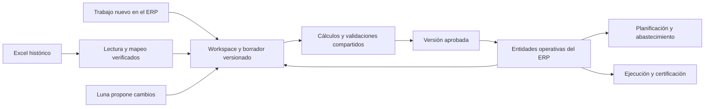

# Plan de implementación del workspace de obra y migración desde Excel

Fecha: 29 de octubre de 2026. Estado: plan de ejecución preparado; las etapas nuevas siguen pendientes. Base de código revisada: `1411e735`.

Seguimiento del primer lote: [implementación y verificación del workspace](PRIMER_LOTE_WORKSPACE_VERIFICACION.md). Los hallazgos de este plan corresponden a la base revisada; ese informe registra las correcciones y la selección posterior de Univer.

El objetivo es que el usuario prepare, planifique y gestione la obra dentro del ERP con la fluidez que necesita para trabajar, calcular y comparar alternativas. La migración desde Excel debe llevar la información anterior a ese mismo espacio. La adopción se medirá por tareas completas realizadas dentro del ERP.

La estrategia es ampliar las piezas existentes mediante un workspace con grillas, hojas auxiliares y vistas conectadas. Los datos operativos mantendrán identidades, unidades, versiones y reglas explícitas. Luna ayudará a interpretar documentos y proponer cambios; la edición y los cálculos cotidianos funcionarán sin depender del modelo.

## 1 Resultado esperado y límites de la primera versión

El responsable de oficina técnica podrá crear una obra desde cero, cargar mediciones, definir partidas y recetas, calcular costos y necesidades de materiales, comparar una alternativa y aprobar una versión. El trabajo quedará guardado y podrá retomarse desde otra sesión.

La siguiente entrega conectará ese trabajo con planificación, abastecimiento y los circuitos existentes de ejecución y certificación. La transición desde Excel se cerrará por obra y por tarea, con responsables y pendientes visibles.

| Capacidad | Primer workspace utilizable | Entrega operativa y migración |
| --- | --- | --- |
| Cómputo y presupuesto | Edición directa, mediciones, agrupaciones y totales | Comparación con versiones anteriores y ejecución |
| APU | Materiales, mano de obra, equipos, transporte y subcontratos | Reutilización y revisión del impacto de cambios |
| Materiales | Necesidades consolidadas y trazabilidad hasta partida | Disponibilidad, entradas previstas y solicitudes mediante circuitos existentes |
| Cronograma | Contrato de datos definido desde el inicio | Fechas, plazos relativos, distribución de cantidades y plan semanal |
| Personalización | Columnas tipadas, vistas guardadas y hojas auxiliares acotadas | Plantillas reutilizables por empresa y ampliación según tareas reales |
| Versiones | Borrador persistente y versión aprobada | Escenarios, comparación y revisión de obras con movimientos |
| Excel histórico | Archivo de referencia y caso de prueba | Importación verificada al mismo workspace |
| Ejecución y certificados | Accesos a funciones existentes | Navegación contextual y verificación completa de sus vínculos |

La primera versión no pretende ejecutar macros VBA, mantener sincronización bidireccional con cualquier Excel, reproducir todas las funciones de Excel ni ofrecer edición simultánea de cada celda al estilo Google Sheets. Las fórmulas disponibles se documentarán y las no admitidas se señalarán. Un archivo Excel tampoco aporta geometría BIM si no contiene esa información; el vínculo BIM seguirá usando la integración IFC correspondiente.

## 2 Base disponible y brechas verificadas

La existencia de código es evidencia para reutilización, no una certificación del recorrido completo.

| Pieza actual | Qué se puede aprovechar | Trabajo necesario |
| --- | --- | --- |
| `components/planillas/PlanillaGrid.tsx` | Grilla, fórmulas, autocompletado, filtros, estilos y deshacer | Validar motor y licencia, rendimiento, referencias y continuidad de edición |
| `app/(internal)/planillas/[id]/planilla-session-client.tsx` | Guardado automático y confirmación de una sesión | Revisiones explícitas, recuperación, conflictos y protección de cambios recientes frente a respuestas atrasadas |
| `lib/planillas/service.ts` | Persistencia de borrador y acceso por empresa | El guardado actual reemplaza el snapshot completo sin una revisión esperada del borrador; necesita control de concurrencia |
| `lib/planillas/types.ts` y `registry.ts` | Identidad estable de filas e interfaz de adaptadores | El registro actual conecta cómputo/presupuesto; ampliar módulos y tipos de columna |
| `lib/workspace/actions.ts`, `context.ts` y `costs.ts` | Acciones compartidas, contexto de licitación/obra y composición de costos | Unificar contratos de cálculo y lectura; parte del cargador y los tipos siguen orientados a PREBID |
| `lib/costing/cost-budget.ts` y `project-prices.ts` | Costeo y selección de fuentes de precio | Mantener la procedencia del precio documental y la misma semántica en todos los consumidores |
| `lib/costing/insumos.ts` | Consolidación de materiales por partida y producto | Representar cantidades pendientes y política de precisión; hoy convierte ausencias a cero y redondea a cuatro decimales |
| `lib/procurement/weekly-plan-engine.ts` | Necesidades semanales, frentes y disponibilidad | Conectar con versiones y cantidades aprobadas del workspace |
| `components/certificates/CertificateWorkbookGrid.tsx` | Vista de libro con Univer | Evaluar si sirve como hoja auxiliar o visor; no asumir equivalencia de sus cálculos con otros motores |
| `lib/workbook-interpretation/*` | Parser, interpretación, mapeo y candidato de importación | Conversión tipada, validaciones bloqueantes y adaptadores reutilizables |
| `create_linked_workbook_project` | Creación atómica de obra y relaciones, reintento idempotente | Unificar validaciones y vincular la aplicación al candidato validado y persistido por el servidor |

### Hallazgos que deben convertirse en tareas de corrección

- `rawNumber` conserva un número nativo `0.125`, pero convierte el texto `"0,125"` en `125`, `"s/d"` en `0` y `"1e3"` en `13`. La transformación de texto exige una regla explícita y casos de prueba.
- Una prueba sintética con una celda `#DIV/0!` produjo una cantidad `7`: se utilizó el código numérico del error sin respetar el tipo de celda. Los errores deben bloquear el dato afectado.
- Algunos mapeos repetidos se resuelven tomando la primera columna y mostrando una advertencia. Una ambigüedad en un campo operativo crítico necesita resolución explícita.
- La ruta de creación con recetas retorna antes del control de presupuesto contra contrato de la ruta tradicional. Debe existir un validador común para ambas.
- La marca de cantidades referenciales se guarda en el candidato y se muestra en pantalla, pero falta un contrato que todos los consumidores puedan aplicar.
- Los plazos individuales se conservan en `budget_items.workbook_schedule`; conservarlos no equivale a integrarlos con toda la planificación.
- El componente de grilla declara `non-commercial-and-evaluation`. La selección de tecnología debe resolver el derecho de uso comercial antes de ampliarlo en producción.

### Qué demuestra la prueba del Lote 2

El archivo tiene 17 hojas, 597 partidas, 597 APU vinculados y 55.682 fórmulas con resultado guardado. La prueba de QA creó 2.199 relaciones de materiales, 1.200 de mano de obra, 896 de equipos, 346 de transporte y un cronograma agregado. También verificó conservación del original, reversión de una transacción fallida y reintento sin duplicar la obra.

Las 597 cantidades de las partidas son `1`. `RESUMEN MATERIALES!A2` pide actualizar la columna E de Ítems con el cómputo métrico real. El total documental de 738.462.025 no debe adoptarse automáticamente como contrato definitivo. Hay seis errores `#REF!` en PLOMERÍA, clasificada como hoja de referencia ajena al presupuesto principal.

Las 597 entradas de plazo relativo corresponden a partidas; no son 597 cronogramas independientes. La prueba tampoco equivale a recalcular íntegramente el libro ni a verificar todos los circuitos del ERP. Las evidencias privadas se conservan en `audit-artifacts/workbook-linked-import/` y no deben incluirse en Git.

## 3 Experiencia de trabajo

El objetivo inicial es escritorio web para oficina técnica. Administración, compras y responsables de obra participarán en la validación del recorrido operativo. Sus permisos se mapearán a los roles existentes durante la etapa P0.

### Estructura del workspace

| Zona | Comportamiento |
| --- | --- |
| Encabezado | Obra, versión activa, estado de guardado y acciones de comparar o aprobar |
| Navegación de trabajo | Cómputo, Presupuesto, APU, Materiales, Cronograma y hojas auxiliares |
| Grilla principal | Editar, pegar rangos, completar, buscar, filtrar, agrupar y seleccionar múltiples filas |
| Panel contextual | APU, mediciones, procedencia o problemas de la partida seleccionada |
| Barra de resultados | Totales y pendientes correspondientes a la selección o al alcance visible |
| Historial | Cambios y versiones con autor, fecha y explicación del efecto |

Cambiar de vista debe conservar selección, filtros y posición. Los totales deben indicar si representan toda la obra o las filas filtradas. Una edición no debe recargar la pantalla ni quitar el foco de la celda.

La aprobación se ofrece cuando existe una versión utilizable; el usuario puede guardar trabajo incompleto. Los errores aparecen junto al dato y tienen una acción concreta para resolverlos. No se exige aprobar cada celda.

### Columnas y hojas auxiliares

Las columnas operativas tienen identidad y significado establecidos. Las columnas adicionales podrán ser texto, número, fecha, selección, referencia o cálculo. Se podrán ordenar, ocultar, fijar y guardar en vistas personales o compartidas con permiso.

Las hojas auxiliares permitirán mediciones y escenarios mediante tablas, constantes y fórmulas admitidas. Los vínculos entre tablas usarán identificadores estables. El usuario podrá vincular un resultado a una cantidad o precio mediante una acción visible que muestre destino, unidad, origen y efecto. Una columna adicional no modificará por sí sola el significado de un dato contractual.

Habrá plantillas iniciales para mediciones por superficie, longitud, volumen y unidades. Una plantilla conserva su estructura y reglas; copiarla a otra obra no reutiliza identificadores ni movimientos de la obra original.

## 4 Recorridos que deben funcionar

| Recorrido | Pasos | Resultado verificable |
| --- | --- | --- |
| Obra nueva | Crear obra, cargar mediciones, vincular partidas, definir APU y revisar presupuesto/materiales | Completar la preparación sin importar un Excel |
| Edición masiva | Pegar un bloque, corregir errores, completar valores, ordenar y deshacer | Se conservan identidad, referencias, selección y cambios guardados |
| Alternativa | Crear escenario, cambiar rendimiento o precio y comparar | La versión vigente conserva sus valores hasta aprobar una revisión |
| Plan de trabajo | Distribuir cantidades por período/frente y revisar necesidades | Totales de planificación consistentes con cantidades y avance |
| Abastecimiento | Revisar necesidades, disponibilidad y entradas; crear una solicitud por el circuito existente | Trazabilidad hasta partidas y versión; no duplicar solicitudes al reintentar |
| Ejecución | Registrar avance, consultar costos y preparar el certificado correspondiente | Usar las reglas y permisos existentes con el contexto de obra correcto |
| Migración histórica | Subir archivo, resolver mapeo, revisar diferencias y crear un borrador | Los datos aparecen en las mismas vistas utilizadas por una obra nueva |

## 5 Arquitectura y límites de responsabilidad

La importación y la edición nativa convergen en el mismo contrato de borrador. Los adaptadores traducen datos; las entidades operativas existentes conservan las reglas del negocio. El proyecto no tendrá una segunda base independiente de presupuesto o stock que compita con la actual.

El navegador muestra resultados inmediatos. Antes de aprobar, el servidor calcula o verifica con la misma versión de reglas, unidades y redondeos. No se acepta un total enviado por el cliente como prueba suficiente de su corrección.

Luna propone operaciones estructuradas sobre el borrador y explica su alcance. No ejecuta SQL ni genera nuevos esquemas de base por archivo. Los datos de una celda se tratan como contenido, nunca como instrucciones para el agente. Toda propuesta queda vinculada a la revisión sobre la que se preparó.

### Decisión sobre motores

P0 comparará las piezas ya instaladas, Handsontable con HyperFormula y Univer, usando una tarea común. Se comprobarán licencia, edición por teclado, pegado, fórmulas requeridas, posibilidad de cálculo en servidor, referencias estables, tamaño del paquete y rendimiento. La mera instalación de una dependencia no determina la elección.

Se elegirá un motor para los cálculos editables del workspace. Si el visor histórico utiliza otro componente, quedará en consulta y no recalculará el original silenciosamente. No habrá dos motores que produzcan resultados operativos diferentes para la misma fórmula.

La matriz inicial de fórmulas incluirá operaciones aritméticas y funciones necesarias para las tareas reales, como suma, condicionales, redondeo y búsquedas admitidas. La lista final se fijará por versión. Se detectarán ciclos, referencias rotas y límites de ejecución. No se admitirán funciones que ejecuten código arbitrario o consulten redes externas.

## 6 Contrato de datos y cálculo

| Concepto | Regla propuesta |
| --- | --- |
| Identidad | Obra, tabla, fila y columna se identifican por ID; la posición visual no identifica una entidad |
| Valor | Conservar tipo, valor original y formato de presentación; vacío, cero, error y no disponible son distintos |
| Cantidad | Registrar unidad, origen y condición referencial o verificada; mantener los estados por dato y derivar el estado del conjunto |
| Precio | Distinguir precio del archivo, cotización, precio adoptado y costo observado; conservar fecha, moneda y procedencia |
| Fórmula | Guardar expresión, referencias estables, resultado, estado y versión del motor; no guardar sólo el resultado |
| Transformación | Registrar regla, entradas y salida para normalizaciones, unidades, rendimientos y escalas |
| Procedencia | Para importados: archivo, hoja, celda/rango y revisión del mapeo; para nativos: autor, operación y revisión |
| Resultado derivado | Propagar dependencias pendientes o referenciales; un resultado incompleto nunca se presenta como total completo |
| Redondeo | Reglas explícitas por moneda, cantidad y operación; redondear donde corresponde y conservar el dato fuente |
| Versión | El borrador referencia una base aprobada; aprobar crea una versión y registra el delta aplicado |

Para importes y consumos sensibles se definirá una política decimal compartida. Si el motor de hoja utiliza coma flotante, sus resultados operativos deberán validarse según esa política. La persistencia en `numeric` no corrige una conversión incorrecta ocurrida antes.

No se adoptará una tolerancia porcentual universal para considerar correcto un total. Cada control tendrá una regla documentada: comparación del valor fuente, regla de redondeo o reconciliación dentro de una tolerancia justificada. Deben coincidir tanto los resultados de cada línea como los totales relevantes.

Las unidades equivalentes, por ejemplo “Metros cuadrados” y `m2`, podrán normalizarse mediante un catálogo aprobado. Conversiones como bolsa a kg requieren una equivalencia conocida del producto. Descripciones parecidas no bastan para fusionar recursos del catálogo.

### Qué significa fidelidad

La lectura de una celda, su interpretación de negocio y el recálculo de su fórmula son verificaciones diferentes. El sistema puede comprobar que conservó exactamente el dato almacenado; eso no demuestra que el resultado guardado de una fórmula esté actualizado ni que una cantidad sea el cómputo real de la obra.

El original se conserva sin modificar. La fórmula original y su resultado guardado son evidencia. Para convertirla en un cálculo editable del ERP se debe demostrar que sus dependencias y funciones tienen una representación equivalente, o sustituirla por una regla de negocio explícita y reconciliada. Un valor importado sin esa equivalencia queda identificado como valor documental; no se presenta como una fórmula que seguirá recalculando.

Si falta un resultado o hay dudas sobre su vigencia, se podrá recalcular una copia con un motor compatible y un entorno autorizado, registrar las diferencias y conservar ambas evidencias. Si ese recálculo no está disponible, el dato queda pendiente. Las funciones no admitidas, macros o vínculos externos nunca se sustituyen silenciosamente por resultados supuestos.

El compromiso verificable es que ningún dato se publique como validado sin cumplir sus controles. No se prometerá interpretar automáticamente el 100 % de cualquier archivo. Se medirán por separado la cobertura automática, las revisiones necesarias y las discrepancias detectadas.

### Estado del trabajo y aplicación

El ciclo será borrador, validación, versión aprobada y, cuando corresponda, nueva revisión. “Guardado” sólo se muestra después de una confirmación del servidor. Un dato referencial puede participar de una simulación claramente indicada; aprobar una operación que lo necesita como definitivo requiere resolverlo.

Las versiones aprobadas se conservan. Volver a un estado anterior crea una revisión; no elimina compras, movimientos ni certificados. El undo del borrador tampoco anula operaciones ya ejecutadas.

### Persistencia propuesta

Antes de crear tablas se hará un inventario del esquema actual. Las siguientes son responsabilidades lógicas, no nombres definitivos de migraciones:

- Workspace y borrador por empresa/obra, con revisión actual y versión base.
- Tablas y columnas configurables, incluyendo propiedades de presentación.
- Filas, mediciones y fórmulas adicionales que no pertenezcan todavía a una entidad operativa.
- Lotes de operaciones de edición con identificador de reintento y revisión esperada.
- Versiones aprobadas y manifiesto de resultados/dependencias.
- Evidencias de origen, mapeos y reportes de validación de importaciones.

Los snapshots servirán para abrir y recuperar versiones. Las ediciones normales enviarán lotes acotados de operaciones. Todas las escrituras tendrán revisión esperada, validación de empresa/contexto y controles de estado dentro de la misma operación atómica.

## 7 Etapas de implementación

| Etapa | Dependencias | Entrega | Complejidad relativa |
| --- | --- | --- | --- |
| P0 Decisiones y base de prueba | Ninguna | Contratos, motor y recorrido de referencia | Media |
| P1 Fiabilidad de datos | P0 | Lectura, conversión y validación comunes | Alta |
| P2 Borrador durable | P0 | Guardado, recuperación, conflictos y aplicación | Alta |
| P3 Workspace de preparación | P1 y P2 | Cómputo, presupuesto y APU conectados | Alta |
| P4 Flexibilidad y escenarios | P3 | Columnas, hojas auxiliares, plantillas y alternativas | Alta |
| P5 Materiales y planificación | P3; usa P4 para escenarios | Necesidades, períodos y plan semanal | Alta |
| P6 Circuito operativo | P5 | Abastecimiento, ejecución y certificación conectados | Alta |
| P7 Migración histórica | Contrato P1/P2; destino P3 | Importación al workspace con reconciliación | Alta |
| P8 Piloto y transición | P4, P6 y P7 | Uso diario en IASA y retiro del Excel operativo acordado | Media, dependiente del piloto |

La duración y el costo se estimarán al cerrar P0, con el motor elegido, los casos reales y las brechas del esquema confirmados. No se fijan fechas de publicación sin esos datos.

### P0 Decisiones y base de prueba

1. Elegir una tarea representativa de oficina técnica y registrar cómo se resuelve hoy, incluyendo pasos fuera del ERP.
2. Medir una ejecución de referencia: duración, cambios de pantalla, pegados, fórmulas, errores y recuperaciones.
3. Inventariar grillas, APIs, cálculos, permisos y tablas existentes; confirmar qué se reutiliza y qué necesita adaptación.
4. Resolver el motor mediante un experimento con 600 partidas, sus APU y un pegado de 1.000 celdas. Revisar uso comercial y licencias de todos los componentes seleccionados.
5. Definir unidades, monedas del primer alcance, funciones admitidas y separación entre precio de venta, costo y contrato.
6. Preparar una maqueta funcional del recorrido y un pequeño caso de referencia revisado por una persona de oficina técnica.

**Salida:** decisión técnica documentada, contrato de datos inicial, lista de tareas del piloto y prueba de que el motor permite la interacción requerida. El prototipo visual solo no cierra esta etapa.

### P1 Fiabilidad de datos

1. Corregir conversiones de texto y respetar tipos de error, fecha, número y texto. Bloquear ambigüedades que afecten valores operativos.
2. Separar lectura de valor, normalización y cálculo. Conservar la evidencia previa a cada transformación.
3. Centralizar validaciones de presupuesto, APU, unidades, catálogo y contrato para importación y edición nativa.
4. Distinguir validaciones informativas de errores que impiden una operación concreta. Mostrar alcance, motivo y acción de resolución.
5. Propagar ausencia, referencia y error a totales y necesidades; eliminar ceros y redondeos implícitos en las rutas involucradas.
6. Garantizar que aplicar un candidato requiera una revisión validada por el servidor y no un JSON arbitrario aportado por el cliente.

**Salida:** los casos de conversión conocidos pasan, los datos inválidos no se materializan y los mismos datos producen el mismo resultado por edición nativa o importación.

### P2 Borrador durable y cambios atómicos

1. Versionar cada borrador. Un guardado recibe revisión esperada y operaciones con identificador idempotente.
2. Evitar que respuestas atrasadas o un reintento sustituyan cambios más recientes. Guardar y confirmar deben comprobar estado y revisión de forma atómica.
3. Implementar recuperación tras recarga o desconexión. Las operaciones sin confirmación se muestran como pendientes; una cola local, si se usa, se separa por usuario/empresa y se limpia al cerrar sesión.
4. Resolver conflictos entre dos pestañas o usuarios conservando ambas propuestas. Primera versión con concurrencia optimista; edición colaborativa en vivo se evalúa después.
5. Calcular y validar antes de aprobar; aplicar el lote completo, fijar versión y registrar evidencia dentro de una transacción.
6. Ante una respuesta incierta, consultar el resultado por ID de operación antes de reintentar.

**Salida:** fallos de red, doble clic, dos pestañas y cierres de sesión no generan pérdidas silenciosas, escrituras parciales ni duplicados.

### P3 Workspace de preparación

1. Crear el acceso desde la obra, con variante habilitada inicialmente en QA y conservación de la navegación actual.
2. Integrar grilla de cómputo/presupuesto con panel de mediciones y APU de la partida seleccionada.
3. Permitir creación, edición, duplicación y operaciones por lote con teclado y pegado. Mantener identificadores al ordenar, filtrar o mover filas.
4. Recalcular cambios con respuesta inmediata y verificar los resultados en servidor antes de aprobar.
5. Representar partidas agrupadoras y ejecutables sin sumar dos veces padres e hijos.
6. Mostrar costo directo, ajustes y precio contractual/comercial con su significado. Un cambio en costo no reemplaza automáticamente un precio contractual aprobado.
7. Mostrar la necesidad bruta de materiales derivada de cantidades y recetas, con acceso a las partidas de origen y pendientes visibles. La disponibilidad y la distribución temporal se incorporan en P5.
8. Ofrecer guardar borrador, revisar pendientes y aprobar versión con un resumen legible de cambios.

**Salida:** se puede crear una obra nueva, cargar mediciones, definir recetas, revisar resultados, aprobar y volver a abrirla sin usar Excel.

### P4 Flexibilidad y escenarios

1. Incorporar columnas tipadas, orden, anchos, filtros, agrupaciones y vistas personales/compartidas.
2. Agregar hojas auxiliares de mediciones y cálculos con funciones admitidas y vínculos explícitos a campos operativos.
3. Conservar referencias al insertar, borrar, mover y renombrar elementos; eliminar una dependencia debe producir un pendiente visible.
4. Crear plantillas de trabajo que copien estructura y reglas sin copiar movimientos ni identidad de otras obras.
5. Permitir un escenario alternativo de cantidades, recetas o precios y compararlo con la base. Aprobar exige comprobar que la base no cambió.
6. Integrar propuestas de Luna como lotes revisables sobre la versión actual. El workspace sigue operativo si Luna falla o tarda.

**Salida:** el usuario puede adaptar el espacio a su tarea, hacer un cálculo auxiliar y comparar una alternativa sin crear una planilla externa.

### P5 Materiales y planificación

1. Ampliar la consolidación de materiales de P3 para usarla en abastecimiento, conservando detalle de partidas, unidad, desperdicio y grado de preparación de los datos.
2. Diferenciar necesidad bruta, stock disponible, reservas y entradas previstas según las reglas existentes. Evitar descontar dos veces la misma disponibilidad.
3. Conectar plazos relativos con fecha de inicio y calendario explícitos. Conservar la escala de origen si todavía falta el anclaje temporal.
4. Identificar si cada serie es monetaria, cantidad física o porcentaje. Un avance financiero no se convierte automáticamente en consumo físico.
5. Permitir distribuir cantidades por período/frente, con suma coherente y límites frente a cantidades aprobadas y ya ejecutadas.
6. Alimentar el motor existente de plan semanal. Si la disponibilidad se vuelve a consultar antes de ejecutar, mostrar el cambio frente a la simulación.

**Salida:** un cambio de cantidad o APU produce necesidades trazables; la programación temporal se reconcilia con la obra y con el avance registrado.

### P6 Circuito operativo

1. Abrir las funciones existentes de solicitudes/cotizaciones y compras desde una necesidad con su contexto, sin volver a cargar partidas o productos.
2. Conservar permisos, aprobaciones e idempotencia de los circuitos actuales; una simulación no emite compras.
3. Verificar recepción, stock y consumo vinculados a obra. Los movimientos reales conservan sus reglas de reversión.
4. Conectar navegación de avance y certificados a partidas/versiones correctas, con cantidades anteriores, del período y acumuladas reconciliadas.
5. Definir el tratamiento de revisiones posteriores a compras, ejecución o certificaciones: impacto visible, historia intacta y límites contractuales explícitos.
6. Crear una matriz por rol de tareas resueltas en el workspace y funciones existentes a las que se accede en contexto.

**Salida:** un recorrido de QA cubre planificación, solicitud, compra, recepción, stock, avance y certificado sin duplicar datos ni reescribir hechos históricos.

### P7 Migración histórica

1. Guardar el archivo original con huella y revisar estructura, tipos, fórmulas, resultados guardados, errores y dependencias externas.
2. Aplicar un mapeo aprobado cuando su estructura sea compatible. Para una estructura nueva, Luna propone el mapeo y el sistema valida sus referencias.
3. Usar adaptadores por familia y transformaciones declarativas permitidas. Cambiar columnas o insertar filas exige redetectar anclajes; no se reutilizan coordenadas ciegamente.
4. Dar cuenta de toda región relevante: importada, excluida con motivo o pendiente. Los bloques comparativos no se incorporan como presupuesto principal por su parecido visual.
5. Reconciliar partidas, APU, materiales y cronograma con controles independientes, incluyendo distinción entre cantidad referencial y definitiva.
6. Generar el mismo borrador que utiliza una obra nueva. La aplicación del conjunto elegido respeta dependencias y es atómica.
7. Reutilizar la interpretación aprobada por estructura y versión; medir por separado exactitud de importación y porcentaje de archivos que requieren revisión.
8. Tratar una nueva carga de la misma obra como propuesta de revisión con diferencias. La identidad de importación combina contexto, archivo, mapeo y operación; una plantilla reutilizada para otra obra no se confunde con un doble envío.
9. Clasificar las fórmulas operativas según su tratamiento: equivalente editable comprobado, regla de negocio reconciliada, valor documental o dependencia pendiente. Verificar vigencia del resultado y cobertura del recálculo antes de permitir su uso definitivo.

**Salida:** Lote 2 y la planilla de obra anterior llegan al workspace con cifras, relaciones y pendientes verificados. Un archivo fuera de cobertura ofrece mapeo asistido o plantilla estándar sin inventar información.

### P8 Piloto y transición

1. Habilitar el workspace por empresa y obra, con seguimiento de errores y una vuelta a la interfaz anterior comprobada.
2. Ejecutar tareas representativas con usuarios de oficina técnica, administración/compras y obra. Registrar toda salida a Excel y su causa.
3. Resolver las carencias que impidan completar las tareas acordadas antes de declarar la sustitución de Excel.
4. Migrar una obra piloto, reconciliar su base, fijar una versión inicial y una fecha de corte. Preservar documentos y hechos anteriores.
5. A partir del corte, producir las nuevas revisiones y operaciones en el ERP. El Excel anterior queda como referencia; exportar un informe no crea una segunda fuente operativa.
6. Incorporar obras activas adicionales por lotes, reconciliando compras, stock, avance y certificados cuando esos datos también deban migrarse. Importar un presupuesto no equivale a migrar toda la historia.

**Salida:** dos ciclos consecutivos de las tareas acordadas se completan dentro del ERP, con resultados reconciliados y sin incidencias críticas abiertas.

## 8 Hitos de entrega y orden de cambios

| Hito | Incluye | Qué se puede afirmar al terminar |
| --- | --- | --- |
| H0 Base decidida | P0 | Hay tecnología, contratos y casos de aceptación definidos |
| H1 Preparación nativa | P1, P2, P3 y P4 | Una obra nueva se prepara dentro del workspace, con personalización y una alternativa comprobada |
| H2 Obra conectada | P4, P5 y P6 | Preparación, planificación y operación conservan sus relaciones |
| H3 Migración utilizable | P7 y controles de H1/H2 | Los archivos anteriores desembocan en el mismo trabajo nativo |
| H4 Transición de IASA | P8 | Las tareas acordadas pasan a realizarse en el ERP |

Los cambios se agruparán en PRs revisables: corrección de datos; contratos/revisiones; persistencia de borrador; integración de grilla; APU/cómputo; personalización; planificación; operación; migración; habilitación del piloto. Cada PR incluirá comportamiento, riesgos y pruebas relevantes. Las migraciones serán aditivas mientras convivan las interfaces.

La migración histórica puede prepararse mientras se construye el workspace, pero no se declarará terminada sin verificar su destino y sus consumidores.

## 9 Pruebas y criterios de aceptación

Los resultados esperados del conjunto de referencia deben ser revisados independientemente del código del importador. Se conservarán archivos privados fuera del repositorio y fixtures pequeños sin datos sensibles dentro de las pruebas.

| ID | Prueba | Resultado exigido |
| --- | --- | --- |
| D01 | Número nativo, texto decimal, miles, negativos, porcentaje y notación científica | Preservar o convertir mediante regla explícita; ambigüedad sin transformación silenciosa |
| D02 | Vacío, `s/d`, `#REF!`, `#DIV/0!` y fórmula sin resultado | Estados diferenciados; ningún código de error se convierte en cantidad válida ni una ausencia en cero |
| D03 | Moneda, unidades y redondeos | Cálculo y persistencia coinciden con la política; transformaciones trazables |
| D04 | Totales correctos con dos líneas erróneas que se compensan | Rechazo por reconciliación de líneas |
| D05 | Cantidades referenciales y precio pendiente | Resultados marcados como provisionales/incompletos en todos los consumidores afectados |
| W01 | Crear obra desde cero hasta presupuesto y materiales | Tarea completa sin archivo Excel |
| W02 | Pegar 1.000 celdas, filtrar, ordenar y deshacer | Identidades, fórmulas y selección coherentes; errores localizados |
| W03 | Cambiar cantidad, rendimiento y desperdicio | Costos, horas y materiales se actualizan sólo en sus dependencias |
| W04 | Mover filas/columnas y renombrar hoja | Las referencias mantienen su significado; roturas explícitas |
| W05 | Hoja auxiliar y escenario | Vínculo comprobable; la base vigente no cambia hasta aprobar |
| S01 | Guardado lento o fallido mientras llegan nuevas ediciones | La respuesta antigua no elimina la edición nueva |
| S02 | Dos pestañas y aprobación concurrente con guardado | Conflicto detectado y ausencia de modificaciones posteriores al cierre de la revisión |
| S03 | Recarga, desconexión y reintento | Recuperación de lo confirmado; pendientes visibles; sin duplicados |
| S04 | Fallo inducido durante aprobación | Ninguna escritura parcial de la versión operativa |
| S05 | Acceso de otra empresa, rol insuficiente y payload alterado | Rechazo por servidor y base; sin filtración de datos |
| I01 | Lote 2 | 597 partidas y 597 APU, cantidades referenciales, errores de PLOMERÍA visibles y original intacto |
| I02 | Planilla de obra anterior | Validar escalas, presupuesto y certificados con resultados independientes |
| I03 | Archivo no usado para ajustar el importador | Importación correcta o rechazo explicable; nunca éxito con datos inventados |
| I04 | Variantes con filas/columnas movidas, encabezados repetidos y comparativos | Mismo significado tras mapeo correcto; ningún bloque de referencia convertido en presupuesto |
| I05 | Nueva carga y doble confirmación | Revisión identificada o mismo resultado; no duplicar obra/recursos por reintento |
| I06 | Fórmula con resultado desactualizado, función no admitida o vínculo externo | Resultado pendiente o recálculo compatible documentado; nunca certificar vigencia por la mera existencia de un valor guardado |
| O01 | Necesidad a solicitud, compra y recepción | Unidades y cantidades consistentes; stock y entradas sin doble descuento |
| O02 | Plan, avance y certificado | Cantidades de período y acumuladas coherentes; sin superar límites aprobados |
| O03 | Cambio de presupuesto con movimientos existentes | Historia preservada y revisión con impacto explícito |
| U01 | Tarea de usuario de principio a fin | Terminar sin ayuda del desarrollador ni cálculo paralelo obligatorio en Excel |

### Objetivos iniciales de rendimiento

Son objetivos de aceptación a medir en QA, no resultados actuales. P0 fijará equipo, navegador, red y datos para que las mediciones sean comparables.

- Caso base: unas 600 partidas, 5.000 componentes de APU y 1.000 celdas en un pegado.
- Respuesta visual a edición/selección: percentil 95 menor de 100 ms.
- Recalcular dependencias de una edición simple: percentil 95 menor de 300 ms en el caso base; trabajos mayores muestran progreso sin bloquear edición.
- Apertura del workspace: objetivo de hasta 3 segundos en condiciones de QA declaradas, con carga progresiva de detalles.
- Confirmación de guardado en red normal: objetivo de hasta 2 segundos después de la pausa de edición. Nunca mostrar “guardado” por vencimiento de un temporizador.
- Probar un caso de 5.000 partidas para establecer límites y comportamiento degradado; no prometer capacidad ilimitada.

La adopción medirá tiempo de tarea frente a la referencia actual, correcciones, pérdida de foco, necesidad de asistencia y motivos de exportación a Excel. El objetivo es que las tareas recurrentes acordadas no sean más lentas que el método actual y que no requieran duplicar datos.

## 10 Publicación y recuperación

Se probará primero en QA con la misma revisión de aplicación y esquema que se pretenda publicar. Después se habilitará a una obra piloto. La expansión dependerá de los criterios de aceptación, no sólo de que compile.

La habilitación se controlará por empresa/obra y capacidad. Se observarán fallos de guardado, conflictos, discrepancias de cálculo, aprobaciones fallidas, tiempo de apertura y estados incompletos. Los registros operativos no incluirán el contenido completo de los archivos ni credenciales.

Volver a la interfaz anterior será un cambio de habilitación. No eliminará versiones ni realizará una reversión destructiva de datos. Si existen columnas o fórmulas que la interfaz anterior no puede editar, conservarlas en consulta y permitir exportación controlada será parte de la prueba de recuperación. Las operaciones ya emitidas se revierten mediante los procedimientos de negocio existentes.

Antes del corte se comprobarán restauración y acceso a originales, compatibilidad de ambas interfaces durante la transición y ausencia de incidencias críticas de cálculo, datos, permisos o recuperación.

## 11 Responsables y decisiones

Los siguientes son roles de trabajo propuestos. Sus responsables se confirmarán al definir el piloto.

| Rol | Responsabilidad |
| --- | --- |
| Responsable de producto IASA | Priorizar tareas, validar comodidad y acordar el corte operativo |
| Referente de oficina técnica | Revisar cómputos, APU, unidades, precios y resultados de referencia |
| Referentes de compras y obra | Validar abastecimiento, ejecución y datos que necesitan para trabajar |
| Implementación | Contratos, interfaz, persistencia, pruebas e integración con módulos existentes |
| Revisión técnica y QA | Validación independiente, regresiones, permisos, recuperación y evidencias |

| Decisión | Valor inicial | Cuándo se cierra |
| --- | --- | --- |
| Motor y licencia | Evaluar componentes existentes con el mismo recorrido | P0, antes de consolidar la interfaz |
| Primera moneda y unidades | PYG y unidades utilizadas en los casos reales; otras quedan explícitas | P0 |
| Tarea piloto | Preparación de obra en oficina técnica | P0 con una ejecución observada |
| Fórmulas admitidas | Conjunto necesario para mediciones, cálculos y escenarios iniciales | P0/P1 |
| Concurrencia | Control optimista con resolución de conflictos | P2 |
| Trabajo sin conexión | Recuperación de pendientes; no prometer operación offline completa | P2 |
| Migración de obras activas | Por obra, con reconciliación y fecha de corte | P7/P8 |
| Nueva obra frente a licitación | Primera interfaz de obra; conservar contratos compartidos con PREBID | P0/P3 |

Las decisiones se resuelven en la etapa correspondiente. El plan no exige que el usuario defina previamente detalles técnicos que pueden verificarse con un experimento.

## 12 Primer lote listo para ejecutar

1. Preparar el caso pequeño revisable de una obra nueva y el recorrido de referencia con los archivos disponibles.
2. Elegir el motor y resolver su uso comercial mediante la prueba común.
3. Corregir los defectos de conversión y tipo de celda con pruebas de regresión.
4. Definir y probar el contrato de cantidad/precio pendiente o referencial en los consumidores del primer recorrido.
5. Agregar revisiones e idempotencia al borrador y probar guardados concurrentes y respuestas atrasadas.
6. Construir la primera vista conectada de cómputo, presupuesto y APU con datos persistidos en QA.

Ese lote se considera terminado cuando permite hacer una preparación sencilla desde cero, cerrar la sesión y retomarla con resultados verificables. La personalización completa, la planificación y la transición operativa avanzan según los hitos posteriores.

## 13 Referencias técnicas

- [SAP Migration Cockpit y tablas de preparación](https://help.sap.com/docs/SAP_S4HANA_ON-PREMISE/29193bf0ebdd4583930b2176cb993268/87ffdbfebd504116b497c02d51ce5b58.html?locale=en-US): estructura de destino y alternativas para poblar datos.
- [SAP mapeo y simulación](https://help.sap.com/docs/PRODUCT_ID/d5699934e7004d048c4801b552f3b013/121b34742a904d10bca907bbf2fd5617.html): validación previa a migración.
- [Microsoft Dynamics y gestión de datos](https://learn.microsoft.com/en-us/dynamics365/fin-ops-core/dev-itpro/data-entities/data-entities-data-packages): entidades, mapeos y área de preparación.
- [SheetJS y fórmulas](https://docs.sheetjs.com/docs/csf/features/formulae/): lectura y escritura no equivalen a evaluación automática.
- [SheetJS y tipos de celda](https://docs.sheetjs.com/docs/csf/cell/): valor, tipo, formato y código de error.
- [Handsontable y licencia](https://handsontable.com/docs/react-data-grid/license-key/): uso comercial y evaluación.
- [HyperFormula y compatibilidad con Excel](https://handsontable.com/docs/hyperformula/guide/compatibility-with-microsoft-excel.html): diferencias que deben considerarse al elegir el conjunto de funciones.
- [Recálculo con Office Scripts](https://learn.microsoft.com/en-us/office/dev/scripts/resources/samples/excel-calculation): alternativa existente para flujos que requieren recalcular con Excel.

Las referencias externas sustentan posibilidades y límites de las herramientas. Los objetivos de rendimiento, etapas y criterios de adopción de este documento son decisiones propuestas para este ERP.
