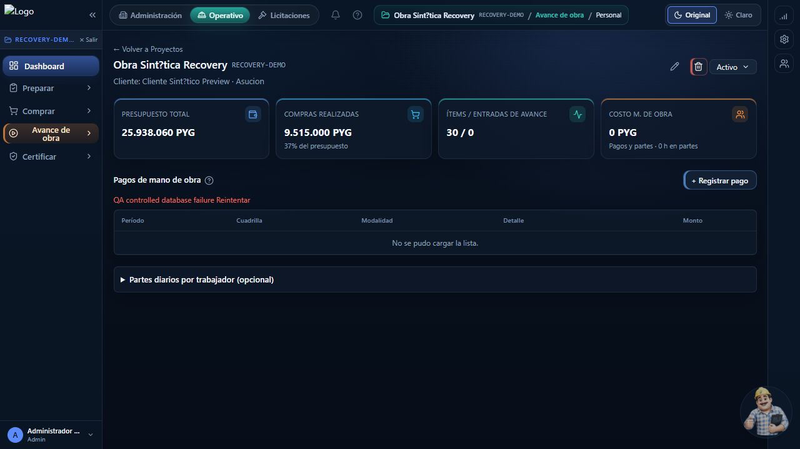
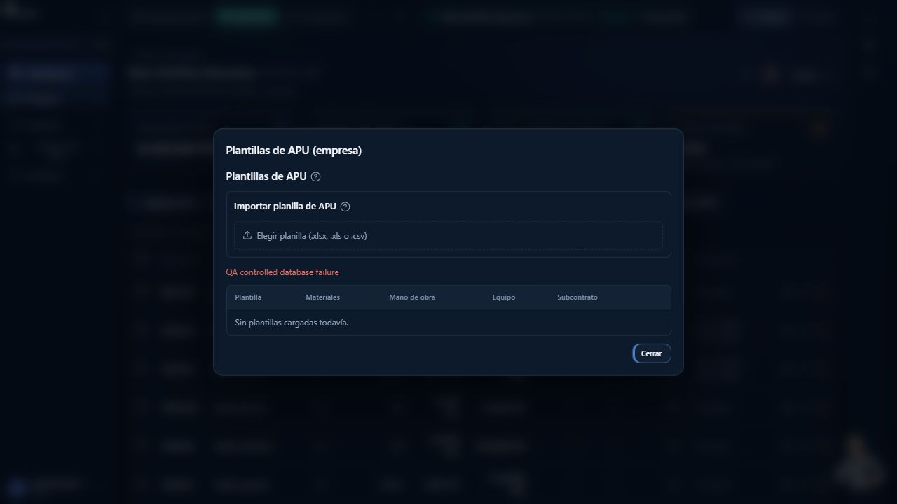

# PR38: pendientes E2E y Fase 6 después de 683e523

Trabajo local en `codex/compras-ventas-merge-prep`. No hubo push, merge ni deploy. Destino de todas las operaciones de base y Storage: **kyiihlkncatojvlasoag**. No se operaron producción, Nexora ni otra rama. No es aprobación de merge.

Código verificado: `907a2ebc7613b61745f82a2fa1fbdf621b43555c`. Build propio `u8zqmvrhgSyS6MZX8MN6Q`. El commit de entrega añade únicamente este informe, arneses y evidencia; no cambia el runtime que se compiló.

## Cambios de producto

| Commit | Hallazgo | Reproducción y corrección |
| --- | --- | --- |
| `0c10758` | #33 | HTTP real devolvía 200 con `{}` cuando PostgreSQL rechazaba el upsert de avance por unidad. Dos regresiones fallaron antes. Ahora se informa el fallo, se rechazan porcentajes no finitos y el grupo se guarda en una sola sentencia. Las dos regresiones y las tres de campos de certificado pasan. |
| `907a2eb` | #39 | La importación DNCP fallaba antes de guardar hijos: `permission denied for function ingestar_proceso_ocds_global`. La baseline concede EXECUTE solo a service_role. Ahora el servidor ya autorizado llama ese RPC con el cliente administrativo y exclusivamente con el documento que acaba de obtener de DNCP. Los guardados privados mantienen el cliente sujeto a RLS. No se ampliaron grants. Regresión roja antes y verde después. |

## A. Observaciones menores

- **#36:** se conserva `ProgressForecastSection`, sin conectarlo a una pantalla. Es código huérfano y su arreglo no acredita un recorrido visible. La acción activa del servidor rechaza coordenadas ausentes/invalidas. El test `weekly-plan-ui-consolidation` documenta que el componente no se renderiza. Su eliminación puede hacerse como limpieza separada; no se lo presenta como cobertura E2E.
- **Semilla:** el nombre sintético guarda literalmente `?` en lugar de la vocal acentuada. Se observó también en nombres de usuario/proyecto. No se corrigieron esos datos para ocultar la observación ni se atribuye a la impresión del ERP.

## B. Evidencia de integración real

Los scripts reproducibles están en `scripts/qa/phase6/`; las respuestas y capturas seleccionadas en `audit-evidence/phase6-2026-10-19/`. Las llamadas de acciones usan el manifest del build y el protocolo FormData de esta versión de Next (prefijo `_1_`, ver decoder instalado). El login QA usa el intercambio OTP oficial del usuario existente, sin enviar correo, crear usuarios ni guardar cookies/tokens en la evidencia.

| Caso | Evidencia y alcance |
| --- | --- |
| #8 RUC distinto | Acción HTTP `resolveInvoiceJob`, original PDF real en Storage, lector real. Devuelve error de RUC; job `needs_review`, factura `PENDIENTE` conservada y cero `invoice_order_matches`. |
| #8 original ilegible | PDF dañado y PNG válido completamente blanco, reales en Storage: error de apertura o RUC no verificable, mismo resultado de conservación y ausencia de vínculo. La imagen pasó por el lector real. `PENDIENTE` es el estado de la factura en el esquema; no se inventa un estado REVISION. |
| #26 carrera | Acción HTTP de evaluación con proveedor meteorológico real. Se retiene la respuesta del SELECT real del evento; otra sesión autenticada confirma el evento; se libera la lectura anterior y la evaluación actualiza mediciones. Lectura final: `CONFIRMED`. No se simuló la respuesta de PostgreSQL. |
| #27 cron | Handler HTTP real con reloj controlado solo en el proceso QA: 02:59:59Z corresponde al día previo de Paraguay, 03:00:00Z al siguiente. Fecha futura, 30 de febrero y texto inválido devuelven 400. Proyecto UUID sin coincidencias para no evaluar otras obras durante el cambio de reloj. El reloj se restablece al terminar. |
| #35 listar APU / mano de obra | Error de base inyectado en el transporte de sus consultas reales. Acción HTTP devuelve error; ambas alertas visibles capturadas en navegador. El diálogo de APU muestra el error y deja de cargar; mano de obra ofrece Reintentar con el formulario cerrado. |
| #35 borrar APU | Acción HTTP con DELETE rechazado: error y success=false; plantilla QA conservada. La confirmación nativa bloqueó el navegador automatizado: el clic de borrado no se cuenta como E2E UI completado. |
| submit_receipt_portal incierto | RPC real confirma una recepción y el transporte pierde su respuesta. HTTP 503; una recepción CONFIRMED y original conservado, descargado y comparado por SHA-256. No se reenvía a ciegas un enlace de recepción de uso único. |
| planillas incierto | Creación por POST `/api/planillas`; RPC real confirma y se pierde su respuesta. HTTP 503; sesión conservada en `confirmed`; reintento sobre el mismo ID devuelve 200 y alreadyConfirmed=true. |
| #32 APU inválido | Acción real con cantidad negativa y creación de materiales habilitada: error, cero plantillas nuevas. |
| #32 certificado inválido | XLSX real y mapeo válido inferido primero de una fila válida; luego se cambia PRESENTE a `no-numero`. El handler rechaza la fila 4 como incompleta/ambigua, sin crear certificados. No se usó un simple archivo corrupto como sustituto de esa prueba. |
| #33 | Repetido sobre el build nuevo: error visible en la respuesta de la acción, sin falso éxito. Además, un grupo con una unidad válida y otra inexistente falla realmente en la base y deja cero filas parciales. Se conserva la reproducción anterior con falso éxito. Falta la comprobación interactiva del aviso en navegador limpio. |
| #34 | POST real crea sesión; PATCH rechazado hace devolver error y conserva el estado UPLOADED. Sin la falla, reintento sobre el mismo ID deja DISCARDED. Lectura posterior confirmó las tres sesiones QA descartadas, sin obra creada desde ellas. |
| #39 | Repetido sobre el build nuevo, tomando el proceso real DNCP 391731: DELETE rechazado y POST de ítems rechazado devuelven importación incompleta con ID de cabecera. Se conserva el fallo anterior de permisos, corregido sin grants nuevos. |

### Cómo probar el cron sin CRON_SECRET remoto

1. En este worktree, verificar que `.env.local` tiene host `kyiihlkncatojvlasoag.supabase.co`; los scripts abortan si difiere.
2. Con build local terminado, ejecutar `node scripts/qa/phase6/serve.cjs`. Inicia el build en localhost:3018 con un CRON_SECRET aleatorio únicamente en memoria. No escribe secretos ni configura Supabase/Vercel.
3. Consultar `http://localhost:4019/cron?date=2026-10-19&project_id=00000000-0000-0000-0000-000000000000`. El helper localhost adjunta el secreto al llamar al handler real. Cambiar la fecha por una futura o inválida prueba el rechazo sin escribir jornadas.
4. Para el límite horario, detener ese proceso al terminar; iniciar `node scripts/qa/phase6/serve-fault.cjs` y ejecutar `QA_BASE=http://localhost:3019 node scripts/qa/phase6/api-checks.cjs` con la sintaxis de variables de la shell utilizada. Su prueba de cron controla/restablece el reloj del proceso, sin cambiar la hora de Windows ni la de Supabase. Nunca ejecutar el preload en producción.
5. Ambos procesos son exclusivamente locales y deben detenerse al terminar. No hace falta pedir ni crear un secreto de producción.

### Por qué faltaban sesiones de importación y cómo repetir #34

La base aislada tenía las tablas y las políticas de sesiones, pero **no tenía el bucket `certificate-workbooks`**. El POST real devolvía `Bucket not found`; no era una sesión creada que luego se perdía. Se creó únicamente ese bucket privado en la branch aislada: XLSX, 10 MB. Se conservaron las políticas de la baseline; no se cambiaron permisos ni se consultó el bucket de producción.

Preparación reproducible: `node scripts/qa/phase6/prepare-workbook-bucket.cjs --create-isolated-bucket`. El script comprueba host, es idempotente y deja constancia de si lo creó. Es configuración del entorno aislado, no una migración de esquema ni una instrucción para producción.

Para crear la sesión sin depender de acertar el recorrido de la UI, con sesión QA autenticada enviar multipart a POST `/api/import-sessions`, campo `file`, XLSX válido menor de 10 MB. El script `api-checks.cjs` genera una planilla con Código, Descripción, Unidad, Cantidad y Precio. La respuesta contiene `sessionId`; la obra todavía no se crea. `after()` puede dejar el análisis en progreso o fallido sin borrar la sesión. Consultar su estado mediante `getImportSession` o la tabla y después llamar `discardImportSession(sessionId)`.

Para probar el fallo, rechazar los PATCH de `workbook_import_sessions` durante ese paso, comprobar error y que no diga DISCARDED, retirar la falla y reintentar con el mismo ID. La falla debe mantenerse durante la llamada: un rechazo de un solo uso puede ser consumido por el análisis en segundo plano antes de que llegue el descarte. No se cuenta ese problema del arnés como defecto del ERP.

## C. Fase 6

### C06: PDF escaneado

Reproducido con PDF de una página que contiene una factura como imagen JPEG y ninguna capa de texto. El lector real devuelve «El PDF no tiene texto ... cargalo como imagen en vez de PDF». No se aceptó ni persistió una factura por esa extracción. Se conserva `c06-scan.pdf` y su respuesta.

**Sigue abierto como limitación de producto.** No se agregó OCR/renderizado de PDF sin haber comprobado límites de páginas, memoria y compatibilidad del runtime de despliegue. La decisión de corregirlo o aceptar expresamente esta limitación corresponde al usuario antes de GO.

### U1: inventario y revisión visual

El inventario histórico tiene **179 entradas: 129 acciones y 50 superficies**, incluidas APIs y exportaciones. No son 179 pantallas. El nuevo registro conserva cada entrada y separa fuente existente, HTTP, inspección visual y teclado. Un HTTP 200 no se convierte en PASS de UX, permisos ni accesibilidad.

En el build final, 36 superficies tuvieron smoke HTTP autenticado sin errores de ruta detectados. Las otras 14 conservan NOT_TESTED por su método de API/exportación o por requerir el token/contexto correspondiente. Las 129 acciones no se marcan como aprobadas por haber cargado una página. La matriz registra los casos exactos, no una extrapolación de cobertura.

Capturas aceptadas:

1. Dashboard: renderizado correcto de indicadores; se ve logo roto en la semilla. No se inspeccionó ni reparó su origen externo.
2. Personal: alerta de fallo de consulta visible, tabla sale de Cargando y ofrece Reintentar.
3. APU: alerta de carga visible en el diálogo, contenido legible y cierre visible.
4. Certificado QA sobre el build nuevo: renderizado y foco visibles. Una pestaña nueva permitió observar la pantalla, pero sus pestañas internas no cambiaron de contenido por clic/Enter en esta sesión de navegador. Se conserva la captura y no se clasifica automáticamente como defecto de producto: debe repetirse en una sesión limpia para descartar el bloqueo del diálogo anterior.

**U1 continúa parcial.** La confirmación nativa de borrado dejó sin respuesta la pestaña del navegador integrado; los intentos de recuperarla/cerrarla y usar Chrome no dieron control utilizable. Finalmente se pudo abrir otra pestaña y observar el certificado, con la limitación del paso 4. No se certifican todas las ayudas, foco, variantes de ancho, roles ni acciones destructivas. Se observó además un botón de papelera de plantilla sin nombre accesible, que debe incluirse en la revisión pendiente de U1. Las pruebas HTTP restantes no sustituyen esa revisión.

### Vistas SECURITY DEFINER

Se leyeron las definiciones instaladas, propietario, opciones, grants, columnas y políticas de las tres tablas fuente. Ambas vistas pertenecen a postgres, sin security_invoker=true, y permiten SELECT a anon/authenticated. La alerta es real y preexistente.

Las definiciones agregan exclusivamente `procurement_bids`, `procurement_suppliers` y `procurement_processes`, con políticas SELECT `true`. No unen empresas, proveedores privados, facturas, cotizaciones internas ni seguimientos de empresa; no contienen empresa_id ni campos de esos registros privados. Sus montos/RUC son del catálogo nacional de licitaciones. La ingestión revisada toma documentos DNCP, no datos de compras privadas. Tras la importación real, la consulta REST anónima y autenticada devuelve los mismos datos públicos: 2 filas contextuales y 8 globales. La igualdad de datos no sustituye la inspección de dependencias SQL ni una auditoría general de todos los escritores privilegiados.

No se encontró en estas definiciones una vía de exposición de datos privados de otra empresa. No es una garantía sobre todo el módulo de procurement ni sobre todo posible escritor privilegiado del catálogo. **No se cambiaron permisos ni opciones de las vistas.** Se conserva la alerta de configuración para decidir su endurecimiento por separado.

### Fallo real de Storage

Se estrechó temporalmente el MIME del bucket **aislado** warehouse-evidence a PNG, guardando antes su configuración. La ruta real de recepción subió primero un PNG válido y luego Storage rechazó un PDF válido. Se comprobó HTTP 502, cero recepciones nuevas y cero objetos residuales: la compensación retiró el primer archivo. En finally se restauraron MIME, límite y visibilidad originales; lectura posterior confirmó coincidencia. No fue un error simulado por proxy.

## Verificaciones finales

- Vitest completo secuencial, timeouts de 60 s: **2429 pasadas, 16 omitidas, cero fallas**; 260 archivos aprobados y 2 omitidos. Duración 955,73 s. Las omitidas no se cuentan como verificadas.
- TypeScript `--noEmit`: aprobado.
- Build `npm run build -- --webpack`: salida 0; compilación, tipos y 59 páginas estáticas terminados. Se ejecutó después de Vitest/PGlite. El aviso de actualización de npm emitido por stderr no fue fallo de build.
- No hay SQL nuevo ni cambio de ledger por estos dos arreglos de aplicación.
- Repetición HTTP de #33/#34/#39, clima, originales, errores de paneles, planillas y recepción/Storage en el build nuevo: aprobada según las variantes y límites de la tabla.
- El arnés final tiene ocho comprobaciones en `api-checks.json`, tres en `climate-dncp.json`, tres variantes de original en `manual-original.json`, tres errores de panel en `panel-action-errors.json` y los dos escenarios de recepción/Storage en sus archivos propios.
- Ledger **11/11**, cinco triggers activos y permisos previos verificados. Asesores: solo las dos alertas de vistas preexistentes descritas arriba.

## Fuera de alcance y residuos QA

No se consultó ni modificó el bucket de producción; no se renovaron QR impresos ni se validó la constraint histórica #4 (continúa NOT VALID). C06 y U1 requieren resolución o decisión explícita del usuario antes de merge. La revisión de Claude sigue siendo necesaria sobre el SHA nuevo.

Los datos QA creados o conservados se identifican en `api-fixture.json`, `qa-residue.json` y las respuestas seleccionadas: proyecto QA fase6, partida, certificado BORRADOR, unidad, sesiones de planilla confirmadas mediante reintento, seis facturas de originales rechazados con jobs en revisión y una plantilla APU cuya eliminación se rechazó. Quedan tres sesiones de importación DISCARDED. La recepción de Storage incierto se probó dos veces sobre la OC sintética existente `OC-2026-0009`, con dos unidades recibidas adicionales en dos recepciones; no se revierte stock inmutable para ocultar la evidencia. La prueba DNCP deja datos públicos de 391731 y una cabecera privada con importación incompleta, deliberadamente conservada para revisión. No se enviaron invitaciones ni mensajes. Los archivos previos del usuario se preservaron.
